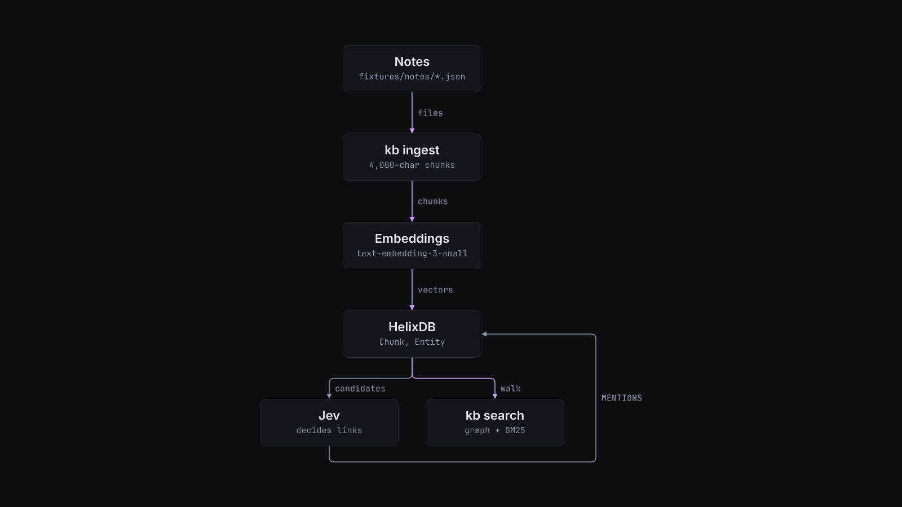

# kb

A command-line knowledgebase on HelixDB that links each passage of your notes and bookmarks to the people, products and topics it discusses, so a search for a name finds the passages about it.


## Why

Embeddings do not find names. A bare name has no context for an embedding model to work with. When this was measured, a nonsense query sat at cosine distance 0.30 from the corpus, the passages that really named the entity sat at 0.30 to 0.33, and unrelated posts sat at 0.32. No distance cutoff separates them. `kb` builds an entity graph instead. Helix proposes candidate entities for each passage, the Jev model decides which ones the passage is really about, and a link is written only at confidence 0.9 or higher. A lookup of up to three words then walks that graph and adds BM25. Longer questions also use vector search. The design, the measurements and the runbook are in [PIPELINE.md](PIPELINE.md).

## Install

Requirements:

- [Bun](https://bun.sh) 1.3 (tested with 1.3.14).
- A running HelixDB v3 instance. The `helix` CLI (tested with 3.0.8) and Docker can start one locally. `kb` never starts containers.
- `OPENAI_API_KEY` for embeddings and `OPENROUTER_API_KEY` for the Jev and GLM calls. Search in `--mode text` and `--mode graph` needs only Helix.
- Python 3 for the optional reader in `reader/` (tested with 3.12.3).

```bash
git clone <this repo> kb && cd kb
bun install --frozen-lockfile
cp config.example.sh config.local.sh   # edit, then:
. ./config.local.sh
```

To start a local Helix instance on the port `kb` expects:

```bash
helix init local --name kb --port 6972
helix start kb
```

Local Helix keeps data in memory. Stopping or restarting the instance wipes it.

## Quick start

The reader needs no Helix and no API keys. It loads the six synthetic notes in `fixtures/notes` into SQLite and serves them:

```console
$ KB_READER_DB=/tmp/kbrun/kb.db python3 reader/server.py &
Setting up database...
Database ready (6 bookmarks imported)
Serving on http://localhost:8421/bookmarks.html
$ curl -s 'localhost:8421/api/articles' | jq -r '.[] | "\(.word_count)  \(.title)"'
31  Compost soil
32  Garden sensors
34  Greenhouse irrigation
32  Rainwater tank
30  Seed library
31  Solar greenhouse
```

With Helix running and both keys set, build the graph and search it:

```bash
bun kb.ts taxonomy --seed --yes        # one LLM call drafts the categories; ingest refuses to run without them
bun kb.ts ingest fixtures/notes
bun kb.ts search "solar greenhouse" --mode graph
```

Against an empty instance, `bun kb.ts stats` prints:

```console
$ HELIX_URL=http://localhost:6983 bun kb.ts stats
0 documents (0 linked) · 0 chunks (0 linked) · 0 entities · 0 categories
```

`bun kb.ts` with no arguments prints every command and filter.

## How it works



`kb.ts` is the whole tool. Before it ingests, it creates the Helix indexes it needs (equality, range, vector and BM25) and waits until they are active.

`kb ingest <dir>` reads one JSON file per document (`id`, `title`, `content`, `url`, `metadata`). For each document it:

1. Skips it when another document already holds every passage, by `contentHash`.
2. Cuts the text into 4,000-character chunks and embeds them with `text-embedding-3-small`.
3. Writes a `SourceDocument` and its `Chunk` nodes in one batch.
4. Links. Helix shortlists up to 30 candidate entities per chunk from its 8 nearest chunks. Jev answers, per chunk, the category, the salience, whether the chunk is boilerplate, and one yes or no per candidate. A `MENTIONS` edge is written at confidence 0.9 or higher.
5. Names. For chunks where Jev said something unnamed is discussed, GLM (`z-ai/glm-5.3-flash` on OpenRouter) proposes names and Jev checks each one.
6. Settles. Every link gets a second reading. An entity on half or more of a document's passages becomes one document-level link.

`kb search` picks a mode from the query. Up to three words, or `--kind x_bookmark`, uses `graph`. Graph mode runs BM25 over entity names, follows `MENTIONS` to the passages about those entities, and fuses that list with BM25 over passage text. Longer queries use `hybrid`, which adds vector search. `--mode graph|hybrid|vector|text` overrides the choice. `--rerank` asks Jev to rerank.

The hygiene commands (`backup`, `check`, `prune`, `vet`, `confirm`, `consolidate`, `dedupe`, `relate`, `model`, `entities --resolve`) are dry runs until you pass `--yes`, and work from the newest backup. [PIPELINE.md](PIPELINE.md) has the order to run them in.

`reader/server.py` is a separate SQLite reader with a REST API (`/api/bookmarks`, `/api/articles`, `/api/stats`, `/api/categories`) and a page at `/bookmarks.html`. `migrate/` holds two one-off scripts. `export_supermemory.py` exports documents from a Supermemory server, and `reindex_vectors.py` repairs vectors on a legacy Helix v1 instance.

## Configuration

Every option is an environment variable. `config.example.sh` sets each one to its default.

| Variable | Default | What it does |
| --- | --- | --- |
| `HELIX_URL` | `http://localhost:6972` | Helix instance that `kb.ts` and `eval.ts` use |
| `KB_TENANT` | `demo` | `tenant_id` on every node; scopes every query |
| `KB_USER` | `owner` | `userId` on documents and chunks |
| `KB_OWNER_NAME` | value of `KB_USER` | Name on the `User` node and in the profile that `kb model` writes |
| `OPENAI_API_KEY` | none | Embeddings. Required for ingest and for `hybrid` and `vector` search |
| `KB_EMBED_URL` | `https://api.openai.com/v1/embeddings` | Embeddings endpoint |
| `OPENROUTER_API_KEY` | none | GLM and Jev calls. Required for taxonomy, ingest, linking and hygiene |
| `KB_MODEL` | `z-ai/glm-5.3-flash` | LLM that names entities and drafts the taxonomy |
| `KB_OPENROUTER_URL` | `https://openrouter.ai/api/v1` | OpenRouter base URL |
| `KB_JEV_ROUTE` | `openrouter` | `openrouter` or `cloudflare` |
| `KB_JEV_URL` | `https://openrouter.ai/api/alpha/decisions` | Jev endpoint on the OpenRouter route |
| `CLOUDFLARE_API_TOKEN`, `CLOUDFLARE_ACCOUNT_ID` | none | Required when `KB_JEV_ROUTE=cloudflare` |
| `CF_AIG_TOKEN` | empty | Optional AI Gateway authorization on the Cloudflare route |
| `KB_CLOUDFLARE_URL` | `https://api.cloudflare.com/client/v4` | Cloudflare API base URL |
| `KB_AI_GATEWAY` | `kb` | AI Gateway name on the Cloudflare route |
| `KB_JEV_CONCURRENCY` | `64` | Jev requests in flight |
| `KB_LLM_CONCURRENCY` | `32` | LLM requests in flight |
| `KB_LLM_TIMEOUT` | `90000` | LLM call timeout in milliseconds |
| `KB_DEDUPE_SHARE` | `1` | Share of a document's passages that must exist elsewhere for `kb dedupe` to remove it |
| `KB_BOOKMARKS` | `./data/bookmarks.jsonl` | Bookmark JSONL for `kb bookmarks` |
| `KB_LABELS` | `./data/labels.jsonl` | Bookmark category labels |
| `KB_SKIP` | `./data/tombstoned.json` | Bookmark ids to skip |
| `KB_BOOKMARK_DB` | `./data/bookmarks.db` | SQLite file with extracted article text |
| `KB_BACKUPS` | `backup/` beside `kb.ts` | Where `kb backup` writes and the hygiene commands read |
| `KB_READER_SOURCE` | `fixtures/notes` | Reader input: a directory of note JSON or a bookmark JSONL file |
| `KB_READER_DB` | `reader/data/bookmarks.db` | Reader SQLite file |
| `KB_READER_HOST` | `127.0.0.1` | Reader bind address |
| `KB_READER_PORT` | `8421` | Reader port |
| `SUPERMEMORY_URL` | `http://127.0.0.1:6767` | `migrate/export_supermemory.py` source server |
| `SUPERMEMORY_TAG` | `demo` | Container tag to export |
| `SUPERMEMORY_EXPORT_DIR` | `./data/supermemory-export` | Export output directory |
| `SUPERMEMORY_EXPORT_LOG` | `./data/export.log` | Export log |
| `SUPERMEMORY_API_KEY` | none | Optional bearer token for the export |
| `HELIX_REINDEX_URL` | `http://localhost:6971/v1/query` | Helix v1 endpoint for `migrate/reindex_vectors.py` |
| `HELIX_REINDEX_LOG` | `./data/reindex.log` | Reindex log |
| `HELIX_API_KEY` | none | Optional bearer token for the reindex |

## Limits

- Ingest, linking and every hygiene command call paid APIs (OpenAI embeddings, Jev and GLM on OpenRouter). The source records about $0.001 for a 4-passage document.
- The fixture ingest and graph search have not been run from this published copy. On an empty Helix instance without API keys, the indexes build, `stats` and `search` answer, and `ingest` stops at the missing taxonomy.
- Helix is single-writer and allows at most 512 text-indexed node mutations per write. A full scan of every link takes 20 to 90 seconds.
- `kb` does not start or manage Helix.
- The reader passes the `sort` query parameter straight into SQL. Bind it to localhost, as the default does.
- `migrate/reindex_vectors.py` targets the old Helix v1 API and drops and recreates chunks. Read it before you run it.

## License

MIT. See [LICENSE](LICENSE).
