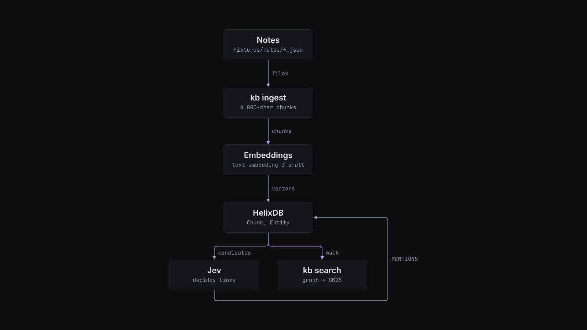

# How kb works

`kb.ts` is the whole tool. Before it ingests, it creates the Helix indexes it needs (equality, range, vector and BM25) and waits until they are active.

`kb ingest <dir>` reads one JSON file per document (`id`, `title`, `content`, `url`, `metadata`). For each document it:

1. Skips it when another document already holds every passage, by `contentHash`.
2. Cuts the text into 4,000-character chunks and embeds them with `text-embedding-3-small`.
3. Writes a `SourceDocument` and its `Chunk` nodes in one batch.
4. Links. Helix shortlists up to 30 candidate entities per chunk from its 8 nearest chunks. Jev answers, per chunk, the category, the salience, whether the chunk is boilerplate, and one yes or no per candidate. A `MENTIONS` edge is written at confidence 0.9 or higher.
5. Names. For chunks where Jev said something unnamed is discussed, GLM (`z-ai/glm-5.3-flash` on OpenRouter) proposes names and Jev checks each one.
6. Settles. Every link gets a second reading. An entity on half or more of a document's passages becomes one document-level link.

`kb search` picks a mode from the query. Up to three words, or `--kind x_bookmark`, uses `graph`. Graph mode runs BM25 over entity names, follows `MENTIONS` to the passages about those entities, and fuses that list with BM25 over passage text. Longer queries use `hybrid`, which adds vector search. `--mode graph|hybrid|vector|text` overrides the choice. `--rerank` asks Jev to rerank.

The hygiene commands (`backup`, `check`, `prune`, `vet`, `confirm`, `consolidate`, `dedupe`, `relate`, `model`, `entities --resolve`) are dry runs until you pass `--yes`, and work from the newest backup. [PIPELINE.md](../PIPELINE.md) has the order to run them in.

`reader/server.py` is a separate SQLite reader with a REST API (`/api/bookmarks`, `/api/articles`, `/api/stats`, `/api/categories`) and a page at `/bookmarks.html`. `migrate/` holds two one-off scripts. `export_supermemory.py` exports documents from a Supermemory server, and `reindex_vectors.py` repairs vectors on a legacy Helix v1 instance.
